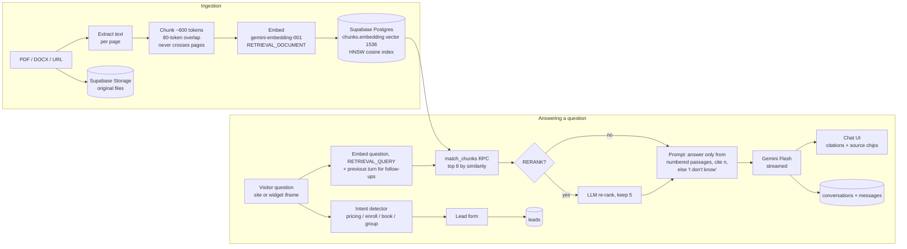

# DocuMind

A RAG chatbot that answers questions from a company's own PDFs, policies and FAQs. Answers cite the file and page they came from. When the documents don't cover a question, the bot says "I don't know". Visitors who ask about pricing or enrolling are offered a short form, and their details are saved as leads.

The demo content is for **Brightpath Training**, a fictional course provider. It has 8 documents: a course catalog, a pricing sheet, a schedule, the enrollment process, instructor bios, a refund policy, an FAQ and a corporate training sheet.

**Stack:** Next.js 15 (App Router), Supabase (Postgres + pgvector, Storage, Auth), Google Gemini (`gemini-3.8-flash` for answers, `gemini-embedding-001` at 1536 dims for embeddings), Vercel.

## Features

- Upload PDF, DOCX, TXT/MD files or web page URLs from the admin, and the bot answers from them
- Streaming answers with highlighted `[n]` citations and source chips (file, page). A chip opens the PDF at that page
- Strict grounding: the bot replies with a fixed "I don't know…" when the answer isn't in the documents
- Lead capture: questions about pricing, enrolling, booking or group training show a name/email form, saved to `leads`
- Admin (Supabase Auth): document list with chunk counts, upload, delete, conversation log with sources, and leads
- Embeddable widget: one `<script>` tag that loads the chat in an iframe on WordPress or any other site
- Eval harness: 20 test questions, scored automatically into `eval/results.md`

## Architecture



| Path | What it does |
|---|---|
| `lib/ingest/` | extract (unpdf, mammoth, Readability), chunk (js-tiktoken), embed, store |
| `lib/rag/` | retrieve, optional re-rank, prompt + citation parsing, answer streaming |
| `lib/intent.ts` | buying-intent detection for lead capture |
| `app/api/chat` | NDJSON stream: `meta` → `text` deltas → `done` (cited sources, lead intent) |
| `app/api/leads`, `app/api/sources/[id]` | save a lead; redirect to a signed URL for a cited file |
| `app/admin/*`, `app/api/admin/*` | admin UI and APIs (Supabase Auth plus optional `ADMIN_EMAILS` allowlist) |
| `public/widget.js` | embeddable launcher + iframe (`/chat?embed=1`) |
| `supabase/migrations/0001_init.sql` | tables, pgvector index, `match_chunks`, RLS, storage bucket |
| `scripts/` | `build-content` (demo PDFs/DOCX), `seed`, `eval` |

## Setup

1. **Supabase**: create a project. In the SQL editor, run `supabase/migrations/0001_init.sql`. This enables pgvector, creates the tables, the `match_chunks` function and the private `documents` storage bucket.
2. **Admin user**: in Supabase go to Authentication → Users → *Add user* and create one with an email and password. Under Authentication → Sign In / Providers, turn off **Allow new users to sign up** so nobody else can create an account. Put that email in `ADMIN_EMAILS`.
3. **Env**: `cp .env.example .env.local`, then fill in the Supabase URL, anon key, service-role key and your Gemini API key (from Google AI Studio).
4. **Install, then load the demo documents**:
   ```bash
   npm install
   npm run content:build   # regenerates content/docs/*.pdf|docx from content/src/*.md (already committed)
   npm run seed            # extracts, chunks, embeds and stores all 8 documents
   npm run dev             # http://localhost:3000
   ```

## Evaluation

```bash
npm run eval
```

This runs the 20 questions in `eval/questions.json` (15 answerable, 5 not covered by the documents) through the real pipeline. An LLM judge compares each answer with the expected answer. Out-of-scope questions pass only if the bot refuses. The script writes `eval/results.md` (a table for the portfolio) and `eval/results.json`.

**Target:** at least 18 of 20 correct, with all 5 out-of-scope questions refused. If the bot falls short, try `RERANK=true`, adjust `MIN_SIMILARITY`/`TOP_K` in `lib/rag/retrieve.ts`, or change the prompt rules in `lib/rag/prompt.ts`.

## Embedding the widget

Add this tag before `</body>`. On WordPress, use a *Custom HTML* block or a footer-scripts plugin.

```html
<script src="https://YOUR-APP.vercel.app/widget.js" defer
        data-color="#1C2A4A" data-position="right" data-label="Ask about courses"></script>
```

On phones the widget opens full screen. Pressing Esc or the × button closes it. Only `/chat` may be framed by other sites (`frame-ancestors *`). Every other page, including the admin, can only be framed by the app itself.

To test it on a separate origin, set the script `src` in `demo-site/index.html` to your app's URL and serve the folder with `npx serve demo-site -l 5000`. The same page is also served by the app at `/demo-site.html`.

## Deploy (Vercel)

1. Push to GitHub and import the repo in Vercel.
2. Add the variables from `.env.example` in Project → Settings → Environment Variables.
3. Deploy. Run `npm run seed` locally with the production Supabase keys if that database is new.
4. Test on a phone: the home page chat, `/demo-site.html` (widget), and the admin.

Vercel limits request bodies to 4.5 MB, so admin uploads are capped at 4 MB per file. The chat route allows up to 60 seconds per response.

## Publishing checklist

- [ ] Live demo link
- [ ] `eval/results.md` with at least 18 of 20 correct and 5 of 5 refusals
- [ ] Architecture diagram (above)
- [ ] 90-second Loom: ask a question → citation chip opens the PDF page → out-of-scope refusal → pricing question → lead form → lead shown in admin → widget on the demo site
